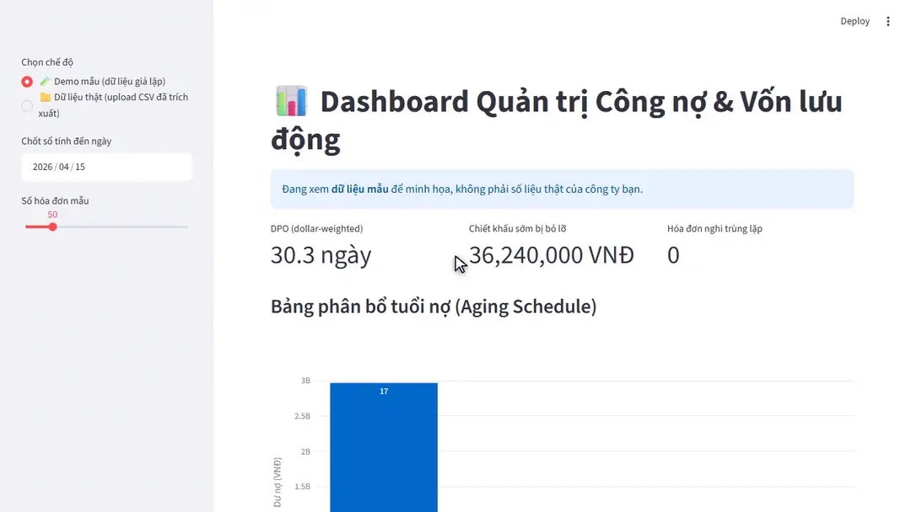
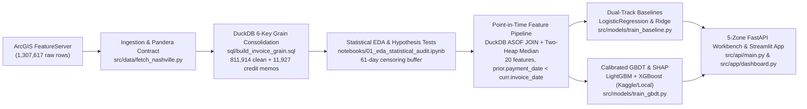

# Financial Accounts Payable Risk & Cashflow Forecasting

An end-to-end, leakage-free Data Science system for **Accounts Payable (AP) Late Payment Risk Scoring** and **Cashflow Timing Forecasting**, built on **1,307,617** real Metro Nashville Vendor Payment records (`$12.94B` across `19,688` independent suppliers).

<p align="center">
  
</p>
<p align="center">
  <sub>Interactive 38s UI Walkthrough · <a href="assets/demo.gif">GIF Fallback (3.7 MB)</a> · <a href="assets/workbench_preview.png">Static Preview</a></sub>
</p>

> **5-Zone Enterprise Workbench UI** (`src/api/main.py` + `src/web/static/`): Left navigation rail, department filter sidebar, 3-track analytical workspace, right-hand model verification & SHAP/invoice inspector, and live telemetry status bar.

---

## 1. Business Problem & Dual-Track Formulation

Municipal and enterprise AP teams face two coupled operational challenges when processing incoming vendor invoices:

1. **Track 1 — Late Payment Risk Scoring (`is_late`: `days_to_pay > 30`)**:
   - **Objective**: Rank incoming invoices at submission time (`invoice_date`) by probability of exceeding the Net-30 Prompt Payment Act threshold.
   - **Actionability**: Prioritize AP approval queues before SLA breaches; at a 5:1 penalty-to-review cost ratio, calibrated **XGBoost** at **Top 20% review capacity** captures **16,494** actual late invoices (**ROI = 2.11x**, net benefit `+43,292` vs `+23,622` for LogisticRegression).
2. **Track 2 — Settlement Timing & Cashflow Forecast (`days_to_pay` via `log1p`/`expm1`)**:
   - **Objective**: Predict exact days to settlement to aggregate citywide 7-day, 14-day, and 30-day cumulative cash outflows for treasury liquidity management.
   - **Actionability**: Reduces pointwise **Test MAE to 8.73 days** (-20.4% vs Ridge `10.97` days) and achieves **0.65% MAPE on 14-day cash outflow** (`$1,769.56M` predicted vs `$1,781.07M` actual).

---

## 2. System Architecture & Anti-Leakage Pipeline



### Core Engineering Guarantees
- **Invoice Grain Resolution**: Raw ArcGIS rows represent line-item budget distributions (`1.52` rows/invoice). DuckDB groups by the 6-key business ID (`Operating_Unit`, `Supplier_Number`, `Invoice_Number`, `Payment_Number`, `Invoice_Date`, `Payment_Date`) with `ROUND(SUM(Distribution_Amount), 2)` to eliminate binary floating-point drift.
- **Zero Post-Payment Leakage**: At `invoice_date = t`, features only read completed payments with `prior.payment_date < t` (strict `<` excludes same-day payments). Post-payment fields (`payment_date`, `payment_number`, `check_amount`, `days_to_pay`, `is_late`) are excluded via the `FEATURE_COLS` contract and verified by `tests/test_no_leakage.py`.
- **$O(N \log N)$ Temporal Aggregation**: Daily prefix-sum tables + DuckDB `ASOF LEFT JOIN` + a two-heap running median compute all 20 features over 811,914 invoices in **~4.04 seconds** (validated 50/50 exact match against brute-force Pandas).

---

## 3. Verified Dataset Audit & Out-of-Time Splits

### Data Quality Audit Funnel (`data/interim/invoices_audit_summary.json`)

| Pipeline Stage | Row Count | Share of Raw | Notes |
| --- | ---: | ---: | --- |
| **1. Raw ArcGIS Feed** | **1,307,617** | 100.00% | Complete pull from Metro Nashville FeatureServer |
| **2. Missing Business Keys Dropped** | **0** | 0.00% | 100% key completeness across all 6 ID columns |
| **3. Bad / Corrupted Dates Dropped** | **57,152** | 4.37% | 81 pre-2015 typos, 190 future typos (e.g. 2083), 56,881 `Invoice_Date > Payment_Date` |
| **4. Valid Distribution Rows** | **1,250,465** | 95.63% | Passed temporal & key integrity checks |
| **5. Consolidated Invoices (`grouped_rows`)** | **823,841** | 63.00% | Invoice-payment grain (`1.52` lines/invoice) |
| **6. Credit Memos Separated** | **11,927** | 0.91% | `invoice_amount <= 0` routed to `invoices_credit.parquet` |
| **7. Clean Positive Invoices** | **811,914** | 62.09% | `invoice_amount > 0` (`24.76%` Net-30 late rate; `30.0d` median, `37.37d` mean) |

### Out-of-Time Temporal Splits (Boundary Bias Controls)

| Split | Invoice Date Window | Invoices | Observed Late Rate | Design Rationale |
| --- | --- | ---: | ---: | --- |
| *Excluded (Left-Truncated)* | `2015-01-16` .. `2022-06-30` | 21,329 | 52.40% | Payment ledger begins `2022-07-01` (on-time early 2022 invoices unrecorded); kept as prior history only |
| **Train** | `2022-07-01` .. `2024-06-30` | **456,414** | 27.53% | 2 complete Nashville fiscal years (4.47% cold-start) |
| **Validation** | `2024-07-01` .. `2024-12-31` | **115,974** | 19.09% | Early stopping, hyperparameter tuning & isotonic calibration (2.17% cold-start) |
| **Test (Hold-out)** | `2025-01-01` .. `2025-10-31` | **195,889** | 20.76% | Final out-of-time evaluation (`$450.44M` late exposure, 1.97% cold-start) |
| *Excluded (Censoring Buffer)* | `2025-11-01` .. `2025-12-31` | 22,308 | 6.24% | **61-day buffer** (`>= p90 = 61d`) eliminating Nov/Dec right-censoring distortion (`0.00%` observed in Dec) |

---

## 4. Model Benchmark Results

### Track 1: Late Payment Risk Classification (`is_late`)

| Split | Model | PR-AUC | ROC-AUC | Brier Score | Lift@5% | Lift@10% | Lift@20% | Value Captured@20% |
| --- | --- | ---: | ---: | ---: | ---: | ---: | ---: | ---: |
| **Val** | Dummy (Train Prior `27.53%`) | 0.1909 | 0.5000 | 0.1616 | 0.94x | 0.97x | 0.99x | 18.39% |
| **Val** | LogisticRegression | 0.3182 | 0.6557 | 0.1501 | 2.37x | 2.10x | 1.71x | **50.67%** (`$133.94M`) |
| **Val** | **LightGBM (Isotonic)** | **0.3485** | **0.7179** | **0.1398** | 2.35x | **2.23x** | 1.97x | 43.75% (`$115.66M`) |
| **Val** | XGBoost (Isotonic) | 0.3465 | 0.7110 | 0.1405 | **2.46x** | 2.22x | **2.01x** | 42.44% (`$112.18M`) |
| **Test** | Dummy (Train Prior `27.53%`) | 0.2076 | 0.5000 | 0.1691 | 1.01x | 1.00x | 1.00x | 21.50% |
| **Test** | LogisticRegression | 0.2984 | 0.5853 | 0.1701 | 2.16x | 1.81x | 1.54x | **40.38%** (`$181.89M`) |
| **Test** | LightGBM (Isotonic) | 0.3896 | 0.7131 | 0.1487 | 2.64x | 2.39x | 1.94x | **42.94%** (`$193.43M`) |
| **Test** | **XGBoost (Isotonic)** | **0.4092** | **0.7252** | **0.1469** | **2.83x** | **2.43x** | **2.03x** | 39.99% (`$180.13M`) |

> **Calibration & Dollar-Weighted Nuance**: On Test, uncalibrated XGBoost achieved a slightly lower Brier score (`0.1459` raw vs `0.1469` isotonic) due to base-rate shift from Val (`19.09%`) to Test (`20.76%`). At Top 10% review capacity, XGBoost captures `$103.75M` (`23.03%`) of late value vs `$80.44M` (`17.86%`) for LogisticRegression.

### Track 2: Settlement Days & Cashflow Horizon Forecast (`days_to_pay`)

| Split | Model | MAE (days) | RMSE (days) | MedianAE (days) | 7d Cashflow MAPE | 14d Cashflow MAPE | 30d Cashflow MAPE |
| --- | --- | ---: | ---: | ---: | ---: | ---: | ---: |
| **Val** | Median Baseline (`30.0d`) | 11.72 | 30.09 | **2.00** | 100.00% | 100.00% | 19.74% |
| **Val** | Ridge (`alpha=10.0`) | 12.76 | 29.57 | 6.14 | 37.74% | 31.88% | **9.64%** |
| **Val** | LightGBM Regressor | 11.32 | 28.73 | 4.46 | 25.06% | **6.89%** | 15.30% |
| **Val** | **XGBoost Regressor** | **11.27** | **28.71** | 4.30 | **22.61%** | 7.93% | 14.47% |
| **Test** | Median Baseline (`30.0d`) | 9.69 | 20.37 | **2.00** | 100.00% | 100.00% | 14.99% |
| **Test** | Ridge (`alpha=10.0`) | 10.97 | 20.14 | 6.64 | 46.37% | 23.67% | **6.65%** |
| **Test** | LightGBM Regressor | 8.75 | 18.58 | **3.94** | 38.82% | 7.06% | 11.06% |
| **Test** | **XGBoost Regressor** | **8.73** | **18.51** | 3.97 | **29.86%** | **0.65%** | 11.94% |

> **Net-30 Cliff Effect Explained**: While the constant `30.0d` median scores `2.00` MedianAE due to the ERP Net-30 payment spike (`p50 = p75 = 30d`), it yields `100.00%` error on 7d and 14d cashflow horizons. Conversely, XGBoost's median Test prediction (`30.81d`) sits just above the 30-day hard cutoff, pushing 75,498 Net-30 invoices (`$560.76M`) across the 30-day boundary (`11.94%` 30d MAPE vs `0.65%` 14d MAPE).

---

## 5. Top SHAP Risk Drivers (`gbdt_metrics.json`, 1,000 Test Samples)

| Rank | Feature | Mean \|SHAP\| | Operational Meaning |
| :---: | --- | ---: | --- |
| 1 | `vendor_prior_late_rate_smoothed` | **0.4294** | Bayesian-smoothed historical late rate of supplier ($\alpha=2.5, \beta=7.5$) |
| 2 | `dept_prior_late_rate` | **0.2836** | Historical approval bottleneck rate of the primary department |
| 3 | `vendor_prior_paid_count` | **0.2153** | Supplier maturity / cold-start vs established vendor signal |
| 4 | `vendor_prior_avg_days_90d` | **0.1782** | Recent 90-day settlement momentum |
| 5 | `days_to_fiscal_year_end` | **0.1172** | Proximity to Metro Nashville's June 30 fiscal year close |

---

## 6. Project Structure & Learning Notes

```text
├── artifacts/
│   ├── eda/                         # 6 publication-grade 300 DPI EDA & hypothesis plots
│   ├── kaggle_results/              # GBDT metrics, SHAP/PR/calibration/cashflow plots, test_predictions.parquet
│   └── baseline_metrics.json        # Local LogisticRegression & Ridge metrics
├── data/
│   ├── raw/                         # Chunked raw ArcGIS Parquet (1,307,617 rows)
│   ├── interim/                     # Grain-resolved clean/credit Parquets + invoices_audit_summary.json
│   └── processed/                   # Point-in-time train/val/test Parquets
├── docs/learning/                   # Vietnamese technical deep-dives & engineering log
│   ├── 00_roadmap_and_concepts.md
│   ├── 01_data_audit_and_sql.md
│   ├── 02_eda_and_statistics.md
│   ├── 03_features_and_leakage.md
│   ├── 04_modeling_and_eval.md
│   └── troubleshooting_log.md
├── notebooks/
│   ├── 01_eda_statistical_audit.ipynb
│   └── 02_kaggle_training.ipynb
├── sql/
│   └── build_invoice_grain.sql
├── src/
│   ├── app/
│   │   ├── dashboard.py             # 3-tab Streamlit portfolio dashboard
│   │   └── loaders.py               # Typed artifact loaders & analytical transforms
│   ├── data/                        # ArcGIS fetcher, Pandera validation, DuckDB builder
│   ├── features/                    # ASOF JOIN + Two-Heap point-in-time feature builder
│   ├── models/                      # Dual-track evaluators, linear baselines, GBDT + SHAP
│   └── config.py                    # Immutable Settings dataclass
└── tests/                           # 31 unit, anti-leakage, smoke, and AppTest tests
```

### Vietnamese Learning Deep-Dives
- [00. Lộ trình Data Science & Khái niệm cốt lõi](docs/learning/00_roadmap_and_concepts.md)
- [01. Kiểm toán dữ liệu & Hợp nhất hạt hóa đơn DuckDB SQL](docs/learning/01_data_audit_and_sql.md)
- [02. Phân tích EDA, Right-Censoring & Kiểm định giả thuyết](docs/learning/02_eda_and_statistics.md)
- [03. Thiết kế đặc trưng Point-in-Time & Chống Data Leakage](docs/learning/03_features_and_leakage.md)
- [04. Huấn luyện GBDT, Hiệu chuẩn xác suất & Phân tích sai số](docs/learning/04_modeling_and_eval.md)
- [Sổ nhật ký xử lý sự cố (Troubleshooting Log)](docs/learning/troubleshooting_log.md)

---

## 7. Reproducible Setup & Run Commands

### 1. Environment Setup
```powershell
python -m venv .venv
.\.venv\Scripts\Activate.ps1
pip install -r requirements.txt
```

### 2. End-to-End Data & Modeling Pipeline
```powershell
# 1. Fetch 1.31M raw Metro Nashville AP records with Pandera schema validation
python -m src.data.fetch_nashville

# 2. Resolve 6-key invoice grain & audit split via DuckDB
python -m src.data.build_dataset

# 3. Engineer 20 strict point-in-time features & out-of-time splits
python -m src.features.build_features

# 4. Train local linear baselines (LogisticRegression + Ridge)
python -m src.models.train_baseline

# 5. Train dual-track LightGBM + XGBoost with Isotonic Calibration & SHAP
#    (or run notebooks/02_kaggle_training.ipynb on Kaggle GPU/CPU)
python -m src.models.train_gbdt --out-dir artifacts/kaggle_results
```

### 3. Automated Test Suite
```powershell
pytest tests/ -v
```

### 4. Launch 5-Zone Enterprise Workbench UI (FastAPI + Tailwind/JS)
```powershell
uvicorn src.api.main:app --reload --port 8000
```
Open `http://127.0.0.1:8000` to explore the 5-zone AP Risk & Cashflow Workbench (or run `streamlit run src/app/dashboard.py` for the classic Streamlit view).
*(If `artifacts/kaggle_results/` is absent, both interfaces automatically fall back to `artifacts/baseline_metrics.json` and EDA summaries.)*
